 

 

  

<table>
  <tr>
    <td align="center"></td>
    <td align="center"></td>
    <td align="center"></td>
    <td align="center"></td>
  </tr>
</table>

---

## 👋 About me

I'm an **AI Product Manager and Technical Business Analyst** based in **Bangalore**, with **14+ years** delivering technology change in **banking, mortgage lending and fintech**. I plan, design and deliver **Agentic AI and GenAI products** end to end, under strict credit-policy, responsible-lending and model-risk guardrails: clear requirements, human-in-the-loop controls, deterministic fallbacks and measurable outcomes.

- 🏦 **Now:** Product Manager / Technical BA at **Commonwealth Bank of Australia**, shipping Agentic AI for home loans, construction lending and Core Banking workflows
- 📉 **Impact:** an AI invoice verification platform that **cut manual verification effort by 34%**, plus AI income verification, RAG lending copilots and the launch of the **Home Guarantee Scheme (HGS/FHBG)**
- 🤖 **Building in public:** AI agents for banking, PM and BA use cases in [**ai-agent-lab**](https://github.com/Neeraj-Mh/ai-agent-lab), built with the Claude API and Gemini, using Claude Code, MCP and Agent Skills
- 📈 **Domain depth:** mortgage origination, Core Banking (CBS) lending modules, Mainframe HLS, cross-border payments and SWIFT ISO 20022, DCM/ECM, syndicated lending and Murex MX.3 FO
- 🎓 **CBAP** (IIBA) · **MBA in Fintech**, BITS Pilani · **B.Tech in ECE**
- 💬 **Ask me about:** AI use-case prioritisation, agent guardrails and evaluation, construction-loan automation, or writing BRDs that engineers actually love

---

## 🎯 What I focus on

<table>
  <tr>
    <td width="33%" valign="top">
      <h3>🤖 Agentic AI in banking</h3>
      Multi-agent, multi-modal workflows, intelligent document processing and RAG copilots with tool calling, HITL checkpoints, guardrails and evaluation metrics (extraction accuracy, precision/recall, hallucination rate, STP rate).
    </td>
    <td width="33%" valign="top">
      <h3>🏦 Mortgages, core banking & payments</h3>
      Australian mortgage origination, construction loans and progressive drawdowns, CBS lending modules and Mainframe HLS, plus trade lifecycle, CCP clearing, ISO 20022 payments and Murex MX.3 FO.
    </td>
    <td width="33%" valign="top">
      <h3>🧭 Product & delivery</h3>
      AI roadmaps, business cases and Jira backlogs. BRDs/FSDs, epics, user stories, acceptance criteria and RTMs. PoC-to-production delivery, UAT/SIT, presales and RFP/RFI bids.
    </td>
  </tr>
</table>

---

## 💼 Experience

| Period | Role | Highlights |
|---|---|---|
| **2023 – now** | **Product Manager / Technical BA**, Agentic AI, Banking, Mortgages & Fintech Commonwealth Bank of Australia · Bangalore | Owns the **AI product roadmap** for mortgage and lending operations. Delivered an **Agentic AI invoice verification** platform (**34% less manual effort**), **AI income verification** for home loans on Mainframe HLS, **RAG copilots** over credit policy, and AI agents integrated with **CBS lending modules** via tool calling. Led the launch of the **Home Guarantee Scheme (HGS/FHBG)**. Set up guardrails, HITL checkpoints, golden datasets and Power BI model monitoring. |
| **2017 – 2023** | **Senior Business Analyst**, Investment Banking, Payments & Trading Systems HCL Technologies · Noida / Bangalore | Lead BA for front-to-back **trade lifecycle and STP** across DCM/ECM, fixed income, FX and money markets. **SWIFT ISO 20022** cross-border payments, CCR and margin requirements, Murex FO support. Led **presales, RFP/RFI bids and PoC demos** for global banking accounts. |
| **2016 – 2017** | **Senior Test Automation Engineer**, Trading Systems & Integration Cigniti Technologies · Hyderabad | Temenos T24 functional testing, API and gateway test automation, **UiPath RPA** bots for banking reconciliations, and sales-engineering PoCs |
| **2015 – 2016** | **Automation Engineer** Coforge · Greater Noida | Automated regression frameworks for backend interfaces, APIs and web services |
| **2011 – 2014** | **Software Engineer** Wipro Technologies · Bangalore | Enterprise web applications, SQL data validation and integration deployments |

---

## 🚀 Featured work

<table>
  <tr>
    <td width="50%" valign="top">
      <h3>🧪 <a href="https://github.com/Neeraj-Mh/ai-agent-lab">AI Agent Lab</a></h3>
      A growing collection of AI agents for <b>banking, PM and BA</b> use cases, with one folder per agent and a new one shipped regularly.  
      <b>Flagship: <a href="https://github.com/Neeraj-Mh/ai-agent-lab/tree/main/VC%20due%20diligence%20team">VC Due Diligence Agent Team</a></b>. Nine agents turn a startup name or URL into live research, Bear/Base/Bull revenue models, a 5-category risk scorecard, an investment memo, an HTML report, an infographic and a <b>4-page BCG/McKinsey-style executive PDF</b>.  
      
      
      
      
    </td>
    <td width="50%" valign="top">
      <h3>⚖️ <a href="https://github.com/Neeraj-Mh/Trade_settlement_exception_resolver_agent">T+1 Settlement Exception Resolver</a></h3>
      Helps operations teams fix settlement failures caused by outdated or unregistered <b>SSIs</b>. It finds instructions in communications, extracts the proposed routing, shows the evidence with a confidence score, and prepares a <b>controlled amendment for human approval</b>.  
      
      
      
    </td>
  </tr>
  <tr>
    <td width="50%" valign="top">
      <h3>🧑‍💼 <a href="https://github.com/Neeraj-Mh/Ai_Recruiter_Agent">Multi-Agent AI Recruitment System</a></h3>
      An end-to-end hiring pipeline. It parses PDF résumés, gives each candidate an <b>LLM match score (0–100)</b> against the role, sends interview invites with Zoom links to qualified applicants, and gives everyone else <b>constructive feedback instead of silence</b>.  
      
      
      
    </td>
    <td width="50%" valign="top">
      <h3>📚 <a href="https://neeraj-mh.github.io/Portfolio/">Capital Markets BRD Library</a></h3>
      Business requirements documents from real-world-style initiatives: 
      • Murex <b>XVA (CVA & FVA)</b> pricing, provisioning and risk framework 
      • Real-time and end-of-day <b>XVA integration</b> platform 
      • Murex ↔ <b>MarkitWire</b> trade affirmation, STP and CCP routing 
      • <b>One Stop Processing</b> for centralised exception handling  
      
      
    </td>
  </tr>
</table>

---

## 🧰 Toolkit

**AI & agents** 

**Banking & capital markets** 

**Tools & tech** 
 

---

## 🏅 Credentials

<table>
  <tr>
    <td align="center" width="33%"><h3>🎖️ CBAP</h3>Certified Business Analysis Professional IIBA</td>
    <td align="center" width="33%"><h3>🎓 MBA, Fintech</h3>BITS Pilani CGPA 8.1 / 10</td>
    <td align="center" width="33%"><h3>⚙️ B.Tech, ECE</h3>Electronics & Communication Engineering IIET University</td>
  </tr>
</table>

---

## 📊 GitHub activity

---

## 🤝 Let's connect

I'm always happy to talk about **Agentic AI in financial services**, **AI product governance**, and **mortgage and core banking transformation**.

 

  

<i>Governed AI, practical automation and measurable delivery for banking.</i>

